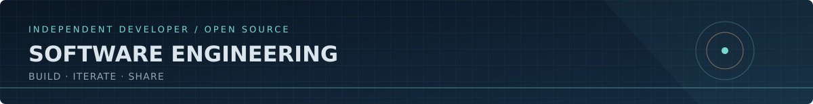
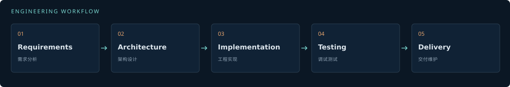

<!-- Generated file. Edit profile/*.yml, profile/modules.yml, and activity/records.yml instead. -->

<picture><source media="(prefers-color-scheme: light)" srcset="./assets/profile/hero.light.svg"/></picture>

Software Engineering · Open Source · Developer Tools

# ZSHEBJTZS

**Independent Developer**

All great ideas and actions begin with a small, seemingly insignificant step.

<a href="https://github.com/zshebjtzs">GitHub</a> &nbsp;·&nbsp; <a href="https://www.luogu.com.cn/user/933414">Luogu</a> &nbsp;·&nbsp; <a href="https://space.bilibili.com/700876219">Bilibili</a> &nbsp;·&nbsp; <a href="https://x.com/zshebjtzs">X</a>

<a href="./README.md">简体中文</a> &nbsp;·&nbsp; <a href="./README.en.md">English</a>

---

## About

<strong>Exploring software engineering and building practical software through open-source development.</strong>

ENGINEERING APPROACH

<strong>AI-assisted Development</strong>

AI tools are used as part of an engineering workflow covering requirements analysis, architecture design, implementation, debugging, testing, and delivery.

<picture><source media="(prefers-color-scheme: light)" srcset="./assets/profile/about.en.light.svg"/></picture>

## Current Focus

<picture><source media="(prefers-color-scheme: light)" srcset="./assets/profile/focus.en.light.svg"/></picture>

## Engineering Principles

<table><tbody><tr><td width="30%"><strong>Problem-first Engineering</strong></td><td>Start from the actual problem and constraints before selecting tools or implementation details.</td></tr><tr><td width="30%"><strong>Modular by Design</strong></td><td>Keep state, rules, rendering, automation, and presentation responsibilities explicit.</td></tr><tr><td width="30%"><strong>Verifiable Delivery</strong></td><td>Prefer reproducible tests, explicit validation, and evidence-backed release states.</td></tr><tr><td width="30%"><strong>AI as an Engineering Tool</strong></td><td>Use AI across analysis, design, implementation, debugging, and testing while retaining engineering judgment.</td></tr></tbody></table>

## Technical Interests

<table><tbody><tr><td width="28%"><strong>Software Architecture</strong></td><td>Modular systems, separation of concerns, maintainability, and practical delivery. Modularity · Maintainability · System Design</td></tr><tr><td width="28%"><strong>Algorithms &amp; Graph Theory</strong></td><td>Data structures, graph models, search, and decision-making algorithms. Data Structures · Graph Theory · Search</td></tr><tr><td width="28%"><strong>Developer Tools &amp; Automation</strong></td><td>Reusable tooling, agent workflows, CI validation, and documentation systems. Developer Experience · Agent Skills · CI/CD</td></tr><tr><td width="28%"><strong>Interactive &amp; Desktop Software</strong></td><td>Browser-based experiences, Canvas rendering, desktop packaging, and asynchronous workers. Web · Canvas · Desktop</td></tr></tbody></table>

## Featured Projects

<table><tbody><tr><td width="33%" valign="top" style="padding:16px">
PROJECT 01 · Maintained

<strong><a href="https://github.com/zshebjtzs/tree-grow-game">TreeGrow — Growth Tree: Graph Theory ↗</a></strong>

A browser-based strategy game built around graph topology and tree growth, featuring procedural Voronoi maps, PVP/PVE, interactive tutorials, save/load, and asynchronous AI decision-making.

Personal Project

     

<a href="https://zshebjtzs.github.io/tree-grow-game/">Live Demo ↗</a>
</td><td width="33%" valign="top" style="padding:16px">
PROJECT 02 · Maintained

<strong><a href="https://github.com/zshebjtzs/my-agent-skills">My Agent Skills ↗</a></strong>

A version-controlled library of reusable agent Skills, paired with a searchable bilingual portal for personal, community, shared, and external Skills.

Personal Project

    

<a href="https://zshebjtzs.github.io/my-agent-skills/">Live Demo ↗</a>
</td><td width="33%" valign="top" style="padding:16px">
PROJECT 03 · In Development

<strong><a href="https://github.com/zshebjtzs/BiliFlow">BiliFlow ↗</a></strong>

A lightweight Windows desktop GUI for yt-dlp, built with Vue 3, TypeScript, Vite, Naive UI, and Neutralinojs. The desktop shell and base interface are in place; download and media-processing features are not yet integrated.

Personal Project

    

</td></tr></tbody></table>

## Other Projects

<table><tbody><tr><td width="100%" valign="top" style="padding:16px">
PROJECT 01 · Needs Review

<strong><a href="https://github.com/zshebjtzs/qdezJDS">qdezJDS ↗</a></strong>

A full-stack community platform with a Vue 3 frontend and a Node.js, Express, and MySQL backend, including forums, file storage, administration, authentication, permissions, and notifications.

Collaboration

     

</td></tr></tbody></table>

## Technical Deep Dives

<table><tbody><tr><td>TreeGrow <strong>AI Decision &amp; Search Architecture</strong> A shared search engine with a TreeGrow adapter, iterative deepening, Alpha-Beta/PVS, transposition tables, and bounded difficulty budgets. Search · Alpha-Beta · PVS · Transposition Table <a href="https://github.com/zshebjtzs/tree-grow-game/pull/33">技术实现与证据 ↗</a></td></tr><tr><td>TreeGrow <strong>Strategic Position Evaluation</strong> Multi-signal position analysis for expansion, defense, root safety, frontier control, and multi-root coordination. Position Evaluation · Spatial Analysis · Decision Support <a href="https://github.com/zshebjtzs/tree-grow-game/pull/36">技术实现与证据 ↗</a></td></tr><tr><td>My Agent Skills <strong>Versioned Agent Skills Catalog</strong> A declarative catalog with source attribution, bilingual discovery, previews, downloads, and automated validation. Catalog Design · Attribution · Automation <a href="https://github.com/zshebjtzs/my-agent-skills">技术实现与证据 ↗</a></td></tr></tbody></table>

## Development Timeline

<table><tbody><tr><td width="18%"><strong>2026-11-11</strong></td><td><strong>TreeGrow Windows Offline Release</strong> Delivered a portable Windows desktop build with WebView2, packaging, and CI smoke tests. <a href="https://github.com/zshebjtzs/tree-grow-game/pull/4">查看交付证据 ↗</a></td></tr><tr><td width="18%"><strong>2026-11-22</strong></td><td><strong>TreeGrow AI Architecture Refactor</strong> Introduced a shared search architecture, adapter boundary, and six difficulty levels. <a href="https://github.com/zshebjtzs/tree-grow-game/pull/33">查看交付证据 ↗</a></td></tr><tr><td width="18%"><strong>2026-11-24</strong></td><td><strong>Strategic Position Evaluation</strong> Added multi-signal strategic analysis for expansion, defense, spatial control, and coordination. <a href="https://github.com/zshebjtzs/tree-grow-game/pull/36">查看交付证据 ↗</a></td></tr></tbody></table>

## GitHub Activity

<picture><source media="(prefers-color-scheme: light)" srcset="./assets/stats/overview.light.svg"/></picture>

<picture><source media="(prefers-color-scheme: light)" srcset="./assets/stats/languages.light.svg"/></picture>

<picture><source media="(prefers-color-scheme: light)" srcset="./assets/stats/contributions.light.svg"/></picture>

Public data is cached from GitHub REST / GraphQL APIs. Commit count uses GitHub public commit search. Updated 2026-11-27.

## Open-Source Contributions

<table><tbody><tr><td style="border-bottom:1px solid #2B4052;padding:10px 8px" width="76%"><a href="https://github.com/zshebjtzs/tree-grow-game/pull/36">[AI] 阶段 C：升级战略局面评估 ↗</a> zshebjtzs/tree-grow-game</td><td align="right" style="border-bottom:1px solid #2B4052;padding:10px 8px">2026-11-24</td></tr><tr><td style="border-bottom:1px solid #2B4052;padding:10px 8px" width="76%"><a href="https://github.com/zshebjtzs/tree-grow-game/pull/33">AI 决策架构重构与六档难度升级 ↗</a> zshebjtzs/tree-grow-game</td><td align="right" style="border-bottom:1px solid #2B4052;padding:10px 8px">2026-11-22</td></tr><tr><td style="border-bottom:1px solid #2B4052;padding:10px 8px" width="76%"><a href="https://github.com/zshebjtzs/tree-grow-game/pull/32">修复 AI 将已生长根节点误判为可生长节点的问题 ↗</a> zshebjtzs/tree-grow-game</td><td align="right" style="border-bottom:1px solid #2B4052;padding:10px 8px">2026-11-22</td></tr><tr><td style="border-bottom:1px solid #2B4052;padding:10px 8px" width="76%"><a href="https://github.com/zshebjtzs/tree-grow-game/pull/31">修复直接攻击非堡垒分叉节点时的整树摧毁结算 ↗</a> zshebjtzs/tree-grow-game</td><td align="right" style="border-bottom:1px solid #2B4052;padding:10px 8px">2026-11-22</td></tr><tr><td style="border-bottom:1px solid #2B4052;padding:10px 8px" width="76%"><a href="https://github.com/zshebjtzs/tree-grow-game/pull/29">修复回放地图背景与逐步导航动画问题 ↗</a> zshebjtzs/tree-grow-game</td><td align="right" style="border-bottom:1px solid #2B4052;padding:10px 8px">2026-11-21</td></tr><tr><td style="border-bottom:1px solid #2B4052;padding:10px 8px" width="76%"><a href="https://github.com/zshebjtzs/tree-grow-game/pull/28">对局回放音效：同步行动事件与播放控制 ↗</a> zshebjtzs/tree-grow-game</td><td align="right" style="border-bottom:1px solid #2B4052;padding:10px 8px">2026-11-21</td></tr><tr><td style="border-bottom:1px solid #2B4052;padding:10px 8px" width="76%"><a href="https://github.com/zshebjtzs/tree-grow-game/pull/27">回放视觉动画 A0–A4：行动复现、时间线交互与回归验证 ↗</a> zshebjtzs/tree-grow-game</td><td align="right" style="border-bottom:1px solid #2B4052;padding:10px 8px">2026-11-21</td></tr><tr><td style="border-bottom:1px solid #2B4052;padding:10px 8px" width="76%"><a href="https://github.com/zshebjtzs/tree-grow-game/pull/4">feat: add Windows offline desktop release ↗</a> zshebjtzs/tree-grow-game</td><td align="right" style="border-bottom:1px solid #2B4052;padding:10px 8px">2026-11-11</td></tr></tbody></table>

## Recent Highlights

<table><tbody><tr><td style="border-bottom:1px solid #2B4052;padding:10px 8px" width="76%"><a href="https://github.com/zshebjtzs/tree-grow-game/pull/36">[AI] 阶段 C：升级战略局面评估 ↗</a> zshebjtzs/tree-grow-game</td><td align="right" style="border-bottom:1px solid #2B4052;padding:10px 8px">2026-11-24</td></tr><tr><td style="border-bottom:1px solid #2B4052;padding:10px 8px" width="76%"><a href="https://github.com/zshebjtzs/tree-grow-game/pull/33">AI 决策架构重构与六档难度升级 ↗</a> zshebjtzs/tree-grow-game</td><td align="right" style="border-bottom:1px solid #2B4052;padding:10px 8px">2026-11-22</td></tr><tr><td style="border-bottom:1px solid #2B4052;padding:10px 8px" width="76%"><a href="https://github.com/zshebjtzs/tree-grow-game/pull/23">大型存档与长棋谱性能优化：F0–F5 ↗</a> zshebjtzs/tree-grow-game</td><td align="right" style="border-bottom:1px solid #2B4052;padding:10px 8px">2026-11-20</td></tr><tr><td style="border-bottom:1px solid #2B4052;padding:10px 8px" width="76%"><a href="https://github.com/zshebjtzs/tree-grow-game/pull/22">R0–R4：完成独立对局回放系统 ↗</a> zshebjtzs/tree-grow-game</td><td align="right" style="border-bottom:1px solid #2B4052;padding:10px 8px">2026-11-17</td></tr><tr><td style="border-bottom:1px solid #2B4052;padding:10px 8px" width="76%"><a href="https://github.com/zshebjtzs/tree-grow-game/pull/15">feat: add complete interactive tutorial experience ↗</a> zshebjtzs/tree-grow-game</td><td align="right" style="border-bottom:1px solid #2B4052;padding:10px 8px">2026-11-15</td></tr></tbody></table>

## Technology Stack

<b>LANGUAGES</b>     

<b>FRAMEWORKS &amp; RUNTIME</b>       

<b>TOOLS &amp; INFRASTRUCTURE</b>    

<b>GRAPHICS &amp; DATA</b>      

## Technology Experience

<table><tbody><tr><td width="28%"><strong>Applied in Projects</strong> Technologies used in shipped or actively maintained projects.</td><td><code>JavaScript</code> <code>TypeScript</code> <code>Vue 3</code> <code>Node.js</code> <code>HTML5</code> <code>CSS3</code> <code>Canvas 2D</code> <code>Vite</code> <code>Git</code> <code>GitHub Actions</code></td></tr><tr><td width="28%"><strong>Core Foundations</strong> Areas with established study and implementation experience.</td><td><code>C++</code> <code>Data Structures</code> <code>Graph Theory</code> <code>Algorithms</code></td></tr><tr><td width="28%"><strong>Exploring</strong> Topics being actively explored through projects and experiments.</td><td><code>AI-assisted Engineering</code> <code>Agent Workflows</code> <code>Software Architecture</code></td></tr></tbody></table>

## Beyond Code

OFF-DUTY DIRECTIVES

<strong>System preferences when off duty.</strong>
<table><tbody><tr><td style="padding:14px 10px">
OFF-DUTY DIRECTIVES / SCI FI FUTURISM

<strong>Sci-Fi &amp; Futurism</strong>

Drawn to grand narratives and unforgiving physical laws—where technology, civilization-scale questions, and the rules of the universe shape possible futures.

Speculative Futures · Cosmic Scale · Hard Science
</td></tr><tr><td style="padding:14px 10px">
OFF-DUTY DIRECTIVES / SURREALIST NARRATIVE

<strong>Surrealist Narrative</strong>

Interested in rule-based horror, meta deconstruction, and liminal spaces—especially how tiny deviations in familiar systems reveal unease and hidden narratives.

Rule-Based Horror · Meta Fiction · Liminal Spaces
</td></tr><tr><td style="padding:14px 10px">
OFF-DUTY DIRECTIVES / GAME MECHANICS

<strong>Game Mechanics</strong>

More interested in dissecting the numbers and state machines beneath a game than simply finishing it: rules, feedback, resource constraints, and decision-making.

Systems Thinking · State Machines · Emergent Gameplay
</td></tr><tr><td style="padding:14px 10px">
OFF-DUTY DIRECTIVES / VISUAL AESTHETICS

<strong>Visual Aesthetics</strong>

Exploring cool palettes, high contrast, and minimalist composition, alongside lo-fi imagery, photo post-processing, and visual information density.

Cool Tones · High Contrast · Minimalism · Lo-Fi
</td></tr><tr><td style="padding:14px 10px">
OFF-DUTY DIRECTIVES / INTERACTIVE FICTION

<strong>Interactive Fiction &amp; Psychological Horror</strong>

Interested in visual novels, psychological horror, and simulation horror—particularly stories that break the fourth wall and question the boundary between player and work.

Visual Novels · Psychological Horror · Fourth-Wall Breaks
</td></tr><tr><td style="padding:14px 10px">
OFF-DUTY DIRECTIVES / INTERNET CULTURE

<strong>Internet Culture &amp; Absurdist Expression</strong>

Interested in internet subcultures, absurdist expression, and satirical memes—especially contextual contrast, displaced symbols, and the hidden logic of collective expression.

Internet Subcultures · Absurdism · Contextual Contrast
</td></tr><tr><td style="padding:14px 10px">
OFF-DUTY DIRECTIVES / GEOSPATIAL EXPLORATION

<strong>Geospatial Exploration</strong>

Enjoys exploring real-world spatial patterns through maps and satellite imagery, connecting geography, urban form, and human activity.

Maps · Satellite Imagery · Spatial Patterns
</td></tr></tbody></table>

## Activity Archive

Browse the complete reviewed activity archive: [activity/ACTIVITY.en.md](./activity/ACTIVITY.en.md).

---

  Living Developer Profile · Facts are collected automatically and published after human review.

