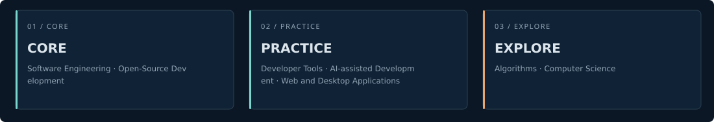
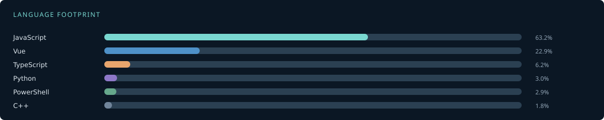
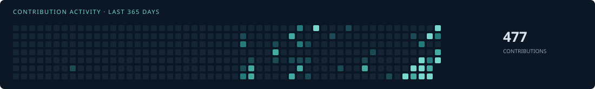

<!-- Generated file. Edit profile/*.yml, profile/modules.yml, and activity/records.yml instead. -->

Software Engineering · Open Source · Developer Tools

# ZSHEBJTZS

**Independent Developer**

All great ideas and actions begin with a small, seemingly insignificant step.

<a href="https://github.com/zshebjtzs">GitHub</a> &nbsp;·&nbsp; <a href="https://www.luogu.com.cn/user/933414">Luogu</a> &nbsp;·&nbsp; <a href="https://space.bilibili.com/700876219">Bilibili</a> &nbsp;·&nbsp; <a href="https://x.com/zshebjtzs">X</a>

<a href="./README.md">简体中文</a> &nbsp;·&nbsp; <a href="./README.en.md">English</a>

---

## About

<strong>Exploring software engineering and building practical software through open-source development.</strong>

ENGINEERING APPROACH

<strong>AI-assisted Development</strong>

AI tools are used as part of an engineering workflow covering requirements analysis, architecture design, implementation, debugging, testing, and delivery.

## Current Focus

## GitHub Activity

Public data is cached from GitHub REST / GraphQL APIs. Commit count uses GitHub public commit search.

## Featured Projects

<table><tbody><tr><td width="33%" valign="top" style="border:1px solid #2B4052;padding:16px;background:#102235">
PROJECT 01 · Maintained

<strong><a href="https://github.com/zshebjtzs/tree-grow-game">TreeGrow — Growth Tree: Graph Theory ↗</a></strong>

A browser-based strategy game built around graph topology and tree growth, featuring procedural Voronoi maps, PVP/PVE, interactive tutorials, save/load, and asynchronous AI decision-making.

Personal Project

     

<a href="https://zshebjtzs.github.io/tree-grow-game/">Live Demo ↗</a>
</td><td width="33%" valign="top" style="border:1px solid #2B4052;padding:16px;background:#102235">
PROJECT 02 · Maintained

<strong><a href="https://github.com/zshebjtzs/my-agent-skills">My Agent Skills ↗</a></strong>

A version-controlled library of reusable agent Skills, paired with a searchable bilingual portal for personal, community, shared, and external Skills.

Personal Project

    

<a href="https://zshebjtzs.github.io/my-agent-skills/">Live Demo ↗</a>
</td><td width="33%" valign="top" style="border:1px solid #2B4052;padding:16px;background:#102235">
PROJECT 03 · In Development

<strong><a href="https://github.com/zshebjtzs/BiliFlow">BiliFlow ↗</a></strong>

A lightweight Windows desktop GUI for yt-dlp, built with Vue 3, TypeScript, Vite, Naive UI, and Neutralinojs. The desktop shell and base interface are in place; download and media-processing features are not yet integrated.

Personal Project

    

</td></tr></tbody></table>

## Other Projects

<table><tbody><tr><td width="100%" valign="top" style="border:1px solid #2B4052;padding:16px;background:#102235">
PROJECT 01 · Needs Review

<strong><a href="https://github.com/zshebjtzs/qdezJDS">qdezJDS ↗</a></strong>

A full-stack community platform with a Vue 3 frontend and a Node.js, Express, and MySQL backend, including forums, file storage, administration, authentication, permissions, and notifications.

Collaboration

     

</td></tr></tbody></table>

## Open-Source Contributions

<table><tbody><tr><td style="border-bottom:1px solid #2B4052;padding:10px 8px" width="76%"><a href="https://github.com/zshebjtzs/tree-grow-game/pull/36">[AI] 阶段 C：升级战略局面评估 ↗</a> zshebjtzs/tree-grow-game</td><td align="right" style="border-bottom:1px solid #2B4052;padding:10px 8px">2026-11-24</td></tr><tr><td style="border-bottom:1px solid #2B4052;padding:10px 8px" width="76%"><a href="https://github.com/zshebjtzs/tree-grow-game/pull/33">AI 决策架构重构与六档难度升级 ↗</a> zshebjtzs/tree-grow-game</td><td align="right" style="border-bottom:1px solid #2B4052;padding:10px 8px">2026-11-22</td></tr><tr><td style="border-bottom:1px solid #2B4052;padding:10px 8px" width="76%"><a href="https://github.com/zshebjtzs/tree-grow-game/pull/32">修复 AI 将已生长根节点误判为可生长节点的问题 ↗</a> zshebjtzs/tree-grow-game</td><td align="right" style="border-bottom:1px solid #2B4052;padding:10px 8px">2026-11-22</td></tr><tr><td style="border-bottom:1px solid #2B4052;padding:10px 8px" width="76%"><a href="https://github.com/zshebjtzs/tree-grow-game/pull/31">修复直接攻击非堡垒分叉节点时的整树摧毁结算 ↗</a> zshebjtzs/tree-grow-game</td><td align="right" style="border-bottom:1px solid #2B4052;padding:10px 8px">2026-11-22</td></tr><tr><td style="border-bottom:1px solid #2B4052;padding:10px 8px" width="76%"><a href="https://github.com/zshebjtzs/tree-grow-game/pull/29">修复回放地图背景与逐步导航动画问题 ↗</a> zshebjtzs/tree-grow-game</td><td align="right" style="border-bottom:1px solid #2B4052;padding:10px 8px">2026-11-21</td></tr><tr><td style="border-bottom:1px solid #2B4052;padding:10px 8px" width="76%"><a href="https://github.com/zshebjtzs/tree-grow-game/pull/28">对局回放音效：同步行动事件与播放控制 ↗</a> zshebjtzs/tree-grow-game</td><td align="right" style="border-bottom:1px solid #2B4052;padding:10px 8px">2026-11-21</td></tr><tr><td style="border-bottom:1px solid #2B4052;padding:10px 8px" width="76%"><a href="https://github.com/zshebjtzs/tree-grow-game/pull/27">回放视觉动画 A0–A4：行动复现、时间线交互与回归验证 ↗</a> zshebjtzs/tree-grow-game</td><td align="right" style="border-bottom:1px solid #2B4052;padding:10px 8px">2026-11-21</td></tr><tr><td style="border-bottom:1px solid #2B4052;padding:10px 8px" width="76%"><a href="https://github.com/zshebjtzs/tree-grow-game/pull/4">feat: add Windows offline desktop release ↗</a> zshebjtzs/tree-grow-game</td><td align="right" style="border-bottom:1px solid #2B4052;padding:10px 8px">2026-11-11</td></tr></tbody></table>

## Recent Highlights

<table><tbody><tr><td style="border-bottom:1px solid #2B4052;padding:10px 8px" width="76%"><a href="https://github.com/zshebjtzs/tree-grow-game/pull/36">[AI] 阶段 C：升级战略局面评估 ↗</a> zshebjtzs/tree-grow-game</td><td align="right" style="border-bottom:1px solid #2B4052;padding:10px 8px">2026-11-24</td></tr><tr><td style="border-bottom:1px solid #2B4052;padding:10px 8px" width="76%"><a href="https://github.com/zshebjtzs/tree-grow-game/pull/33">AI 决策架构重构与六档难度升级 ↗</a> zshebjtzs/tree-grow-game</td><td align="right" style="border-bottom:1px solid #2B4052;padding:10px 8px">2026-11-22</td></tr><tr><td style="border-bottom:1px solid #2B4052;padding:10px 8px" width="76%"><a href="https://github.com/zshebjtzs/tree-grow-game/pull/23">大型存档与长棋谱性能优化：F0–F5 ↗</a> zshebjtzs/tree-grow-game</td><td align="right" style="border-bottom:1px solid #2B4052;padding:10px 8px">2026-11-20</td></tr><tr><td style="border-bottom:1px solid #2B4052;padding:10px 8px" width="76%"><a href="https://github.com/zshebjtzs/tree-grow-game/pull/22">R0–R4：完成独立对局回放系统 ↗</a> zshebjtzs/tree-grow-game</td><td align="right" style="border-bottom:1px solid #2B4052;padding:10px 8px">2026-11-17</td></tr><tr><td style="border-bottom:1px solid #2B4052;padding:10px 8px" width="76%"><a href="https://github.com/zshebjtzs/tree-grow-game/pull/15">feat: add complete interactive tutorial experience ↗</a> zshebjtzs/tree-grow-game</td><td align="right" style="border-bottom:1px solid #2B4052;padding:10px 8px">2026-11-15</td></tr></tbody></table>

## Milestones

Milestones are archived only after their date, evidence, and significance are verified.

## Technology Stack

<b>LANGUAGES</b>     

<b>FRAMEWORKS &amp; RUNTIME</b>       

<b>TOOLS &amp; INFRASTRUCTURE</b>    

<b>GRAPHICS &amp; DATA</b>      

## Activity Archive

Browse the complete reviewed activity archive: [activity/ACTIVITY.en.md](./activity/ACTIVITY.en.md).

---

  Living Developer Profile · Facts are collected automatically and published after human review.

