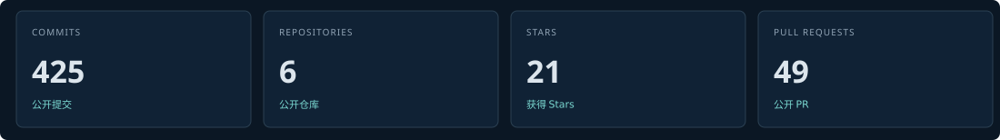

<!-- Generated file. Edit profile/*.yml, profile/modules.yml, and activity/records.yml instead. -->

软件工程 · 开源协作 · 开发者工具

# ZSHEBJTZS

**独立开发者**

一切伟大的思想和行动，都源于一个微不足道的开始。

<a href="https://github.com/zshebjtzs">GitHub</a> &nbsp;·&nbsp; <a href="https://www.luogu.com.cn/user/933414">Luogu</a> &nbsp;·&nbsp; <a href="https://space.bilibili.com/700876219">Bilibili</a> &nbsp;·&nbsp; <a href="https://x.com/zshebjtzs">X</a>

<a href="./README.md">简体中文</a> &nbsp;·&nbsp; <a href="./README.en.md">English</a>

---

## 关于我

<strong>通过开源实践探索软件工程，持续构建解决实际问题的软件。</strong>

工程方法 / ENGINEERING APPROACH

<strong>AI 辅助工程化开发</strong>

将 AI 工具融入完整的软件工程流程，覆盖需求分析、架构设计、实现、调试、 测试与交付，而不将其视为替代工程判断的捷径。

## 当前关注

## GitHub 活动

数据来自 GitHub REST / GraphQL API，定期缓存；提交数使用 GitHub 公开 Commit Search 统计。

## 精选项目

<table><tbody><tr><td width="33%" valign="top" style="border:1px solid #2B4052;padding:16px;background:#102235">
PROJECT 01 · 持续维护

<strong><a href="https://github.com/zshebjtzs/tree-grow-game">TreeGrow — Growth Tree: Graph Theory ↗</a></strong>

一款围绕图结构与树生长机制设计的浏览器策略游戏，包含程序化 Voronoi 地图、PVP/PVE、交互式教程、存档读档与异步 AI 决策。

个人项目

     

<a href="https://zshebjtzs.github.io/tree-grow-game/">在线体验 ↗</a>
</td><td width="33%" valign="top" style="border:1px solid #2B4052;padding:16px;background:#102235">
PROJECT 02 · 持续维护

<strong><a href="https://github.com/zshebjtzs/my-agent-skills">My Agent Skills ↗</a></strong>

版本化管理的可复用 Agent Skills 库，配套双语检索门户，支持个人、社区、共享及外部来源的 Skills。

个人项目

    

<a href="https://zshebjtzs.github.io/my-agent-skills/">在线体验 ↗</a>
</td><td width="33%" valign="top" style="border:1px solid #2B4052;padding:16px;background:#102235">
PROJECT 03 · 开发中

<strong><a href="https://github.com/zshebjtzs/BiliFlow">BiliFlow ↗</a></strong>

基于 Vue 3、TypeScript、Vite、Naive UI 与 Neutralinojs 构建的轻量 Windows yt-dlp 桌面 GUI。目前已完成桌面外壳与基础界面，下载及媒体处理功能尚未集成。

个人项目

    

</td></tr></tbody></table>

## 其他项目

<table><tbody><tr><td width="100%" valign="top" style="border:1px solid #2B4052;padding:16px;background:#102235">
PROJECT 01 · 待确认

<strong><a href="https://github.com/zshebjtzs/qdezJDS">qdezJDS ↗</a></strong>

一个基于 Vue 3 前端与 Node.js、Express、MySQL 后端构建的全栈社区平台，包含论坛、文件云、管理后台、身份认证、权限控制与通知功能。

协作项目

     

</td></tr></tbody></table>

## 开源贡献

<table><tbody><tr><td style="border-bottom:1px solid #2B4052;padding:10px 8px" width="76%"><a href="https://github.com/zshebjtzs/tree-grow-game/pull/36">[AI] 阶段 C：升级战略局面评估 ↗</a> zshebjtzs/tree-grow-game</td><td align="right" style="border-bottom:1px solid #2B4052;padding:10px 8px">2026-11-24</td></tr><tr><td style="border-bottom:1px solid #2B4052;padding:10px 8px" width="76%"><a href="https://github.com/zshebjtzs/tree-grow-game/pull/33">AI 决策架构重构与六档难度升级 ↗</a> zshebjtzs/tree-grow-game</td><td align="right" style="border-bottom:1px solid #2B4052;padding:10px 8px">2026-11-22</td></tr><tr><td style="border-bottom:1px solid #2B4052;padding:10px 8px" width="76%"><a href="https://github.com/zshebjtzs/tree-grow-game/pull/32">修复 AI 将已生长根节点误判为可生长节点的问题 ↗</a> zshebjtzs/tree-grow-game</td><td align="right" style="border-bottom:1px solid #2B4052;padding:10px 8px">2026-11-22</td></tr><tr><td style="border-bottom:1px solid #2B4052;padding:10px 8px" width="76%"><a href="https://github.com/zshebjtzs/tree-grow-game/pull/31">修复直接攻击非堡垒分叉节点时的整树摧毁结算 ↗</a> zshebjtzs/tree-grow-game</td><td align="right" style="border-bottom:1px solid #2B4052;padding:10px 8px">2026-11-22</td></tr><tr><td style="border-bottom:1px solid #2B4052;padding:10px 8px" width="76%"><a href="https://github.com/zshebjtzs/tree-grow-game/pull/29">修复回放地图背景与逐步导航动画问题 ↗</a> zshebjtzs/tree-grow-game</td><td align="right" style="border-bottom:1px solid #2B4052;padding:10px 8px">2026-11-21</td></tr><tr><td style="border-bottom:1px solid #2B4052;padding:10px 8px" width="76%"><a href="https://github.com/zshebjtzs/tree-grow-game/pull/28">对局回放音效：同步行动事件与播放控制 ↗</a> zshebjtzs/tree-grow-game</td><td align="right" style="border-bottom:1px solid #2B4052;padding:10px 8px">2026-11-21</td></tr><tr><td style="border-bottom:1px solid #2B4052;padding:10px 8px" width="76%"><a href="https://github.com/zshebjtzs/tree-grow-game/pull/27">回放视觉动画 A0–A4：行动复现、时间线交互与回归验证 ↗</a> zshebjtzs/tree-grow-game</td><td align="right" style="border-bottom:1px solid #2B4052;padding:10px 8px">2026-11-21</td></tr><tr><td style="border-bottom:1px solid #2B4052;padding:10px 8px" width="76%"><a href="https://github.com/zshebjtzs/tree-grow-game/pull/4">feat: add Windows offline desktop release ↗</a> zshebjtzs/tree-grow-game</td><td align="right" style="border-bottom:1px solid #2B4052;padding:10px 8px">2026-11-11</td></tr></tbody></table>

## 近期动态

<table><tbody><tr><td style="border-bottom:1px solid #2B4052;padding:10px 8px" width="76%"><a href="https://github.com/zshebjtzs/tree-grow-game/pull/36">[AI] 阶段 C：升级战略局面评估 ↗</a> zshebjtzs/tree-grow-game</td><td align="right" style="border-bottom:1px solid #2B4052;padding:10px 8px">2026-11-24</td></tr><tr><td style="border-bottom:1px solid #2B4052;padding:10px 8px" width="76%"><a href="https://github.com/zshebjtzs/tree-grow-game/pull/33">AI 决策架构重构与六档难度升级 ↗</a> zshebjtzs/tree-grow-game</td><td align="right" style="border-bottom:1px solid #2B4052;padding:10px 8px">2026-11-22</td></tr><tr><td style="border-bottom:1px solid #2B4052;padding:10px 8px" width="76%"><a href="https://github.com/zshebjtzs/tree-grow-game/pull/23">大型存档与长棋谱性能优化：F0–F5 ↗</a> zshebjtzs/tree-grow-game</td><td align="right" style="border-bottom:1px solid #2B4052;padding:10px 8px">2026-11-20</td></tr><tr><td style="border-bottom:1px solid #2B4052;padding:10px 8px" width="76%"><a href="https://github.com/zshebjtzs/tree-grow-game/pull/22">R0–R4：完成独立对局回放系统 ↗</a> zshebjtzs/tree-grow-game</td><td align="right" style="border-bottom:1px solid #2B4052;padding:10px 8px">2026-11-17</td></tr><tr><td style="border-bottom:1px solid #2B4052;padding:10px 8px" width="76%"><a href="https://github.com/zshebjtzs/tree-grow-game/pull/15">feat: add complete interactive tutorial experience ↗</a> zshebjtzs/tree-grow-game</td><td align="right" style="border-bottom:1px solid #2B4052;padding:10px 8px">2026-11-15</td></tr></tbody></table>

## 里程碑

里程碑仅在日期、证据与长期意义确认后归档。

## 技术栈

<b>语言</b>     

<b>框架与运行时</b>       

<b>工具与基础设施</b>    

<b>图形与数据</b>      

## 活动档案

完整的已审核活动记录见 [activity/ACTIVITY.md](./activity/ACTIVITY.md)。

---

  动态开发者主页 · 自动追踪事实，人工审核与精选。

