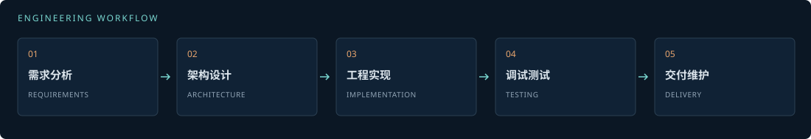
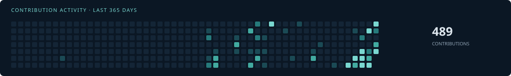

<!-- Generated file. Edit profile/*.yml, profile/modules.yml, and activity/records.yml instead. -->

<picture><source media="(prefers-color-scheme: light)" srcset="./assets/profile/hero.light.svg"/></picture>

软件工程 · 开源协作 · 开发者工具

# ZSHEBJTZS

**独立开发者**

一切伟大的思想和行动，都源于一个微不足道的开始。

<a href="https://github.com/zshebjtzs">GitHub</a> &nbsp;·&nbsp; <a href="https://www.luogu.com.cn/user/933414">Luogu</a> &nbsp;·&nbsp; <a href="https://space.bilibili.com/700876219">Bilibili</a> &nbsp;·&nbsp; <a href="https://x.com/zshebjtzs">X</a>

<a href="./README.md">简体中文</a> &nbsp;·&nbsp; <a href="./README.en.md">English</a>

---

## 关于我

<strong>通过开源实践探索软件工程，持续构建解决实际问题的软件。</strong>

工程方法 / ENGINEERING APPROACH

<strong>AI 辅助工程化开发</strong>

将 AI 工具融入完整的软件工程流程，覆盖需求分析、架构设计、实现、调试、 测试与交付，而不将其视为替代工程判断的捷径。

<picture><source media="(prefers-color-scheme: light)" srcset="./assets/profile/about.zh.light.svg"/></picture>

## 当前关注

<picture><source media="(prefers-color-scheme: light)" srcset="./assets/profile/focus.zh.light.svg"/></picture>

## 工程理念

<table><tbody><tr><td width="30%"><strong>问题驱动</strong></td><td>先明确真实问题与约束，再决定工具、架构和实现方式。</td></tr><tr><td width="30%"><strong>模块化与职责分离</strong></td><td>明确划分状态、规则、渲染、自动化与展示职责，降低模块间耦合。</td></tr><tr><td width="30%"><strong>可验证的交付</strong></td><td>重视可复现测试、显式校验，以及有证据支撑的发布状态。</td></tr><tr><td width="30%"><strong>将 AI 纳入工程流程</strong></td><td>将 AI 用于分析、设计、实现、调试与测试，同时保留独立的工程判断。</td></tr></tbody></table>

## 技术兴趣

<table><tbody><tr><td width="28%"><strong>软件架构</strong></td><td>模块化系统、职责分离、可维护性与工程交付。 模块化 · 可维护性 · 系统设计</td></tr><tr><td width="28%"><strong>算法与图论</strong></td><td>数据结构、图模型、搜索与决策算法。 数据结构 · 图论 · 搜索算法</td></tr><tr><td width="28%"><strong>开发者工具与自动化</strong></td><td>可复用工具、Agent 工作流、CI 校验与文档系统。 开发者体验 · Agent Skills · CI/CD</td></tr><tr><td width="28%"><strong>交互式与桌面软件</strong></td><td>浏览器交互体验、Canvas 渲染、桌面封装与异步 Worker。 Web · Canvas · 桌面应用</td></tr></tbody></table>

## 精选项目

<table><tbody><tr><td width="33%" valign="top" style="padding:16px">
PROJECT 01 · 持续维护

<strong><a href="https://github.com/zshebjtzs/tree-grow-game">TreeGrow — Growth Tree: Graph Theory ↗</a></strong>

一款围绕图结构与树生长机制设计的浏览器策略游戏，包含程序化 Voronoi 地图、PVP/PVE、交互式教程、存档读档与异步 AI 决策。

个人项目

     

<a href="https://zshebjtzs.github.io/tree-grow-game/">在线体验 ↗</a>
</td><td width="33%" valign="top" style="padding:16px">
PROJECT 02 · 持续维护

<strong><a href="https://github.com/zshebjtzs/my-agent-skills">My Agent Skills ↗</a></strong>

版本化管理的可复用 Agent Skills 库，配套双语检索门户，支持个人、社区、共享及外部来源的 Skills。

个人项目

    

<a href="https://zshebjtzs.github.io/my-agent-skills/">在线体验 ↗</a>
</td><td width="33%" valign="top" style="padding:16px">
PROJECT 03 · 开发中

<strong><a href="https://github.com/zshebjtzs/BiliFlow">BiliFlow ↗</a></strong>

基于 Vue 3、TypeScript、Vite、Naive UI 与 Neutralinojs 构建的轻量 Windows yt-dlp 桌面 GUI。目前已完成桌面外壳与基础界面，下载及媒体处理功能尚未集成。

个人项目

    

</td></tr></tbody></table>

## 其他项目

<table><tbody><tr><td width="100%" valign="top" style="padding:16px">
PROJECT 01 · 待确认

<strong><a href="https://github.com/zshebjtzs/qdezJDS">qdezJDS ↗</a></strong>

一个基于 Vue 3 前端与 Node.js、Express、MySQL 后端构建的全栈社区平台，包含论坛、文件云、管理后台、身份认证、权限控制与通知功能。

协作项目

     

</td></tr></tbody></table>

## 技术专题

<table><tbody><tr><td>TreeGrow <strong>AI 决策与搜索架构</strong> 通过 TreeGrow 适配器接入统一搜索引擎，结合迭代加深、Alpha-Beta/PVS、置换表与受控搜索预算。 搜索 · Alpha-Beta · PVS · 置换表 <a href="https://github.com/zshebjtzs/tree-grow-game/pull/33">技术实现与证据 ↗</a></td></tr><tr><td>TreeGrow <strong>战略局面评估</strong> 对扩张、防守、根安全、前线控制与多根协同进行多信号局面分析。 局面评估 · 空间分析 · 决策支持 <a href="https://github.com/zshebjtzs/tree-grow-game/pull/36">技术实现与证据 ↗</a></td></tr><tr><td>My Agent Skills <strong>版本化 Agent Skills 目录</strong> 通过声明式目录管理来源归属，提供双语检索、预览、下载与自动化校验。 目录设计 · 来源追踪 · 自动化 <a href="https://github.com/zshebjtzs/my-agent-skills">技术实现与证据 ↗</a></td></tr></tbody></table>

## 开发历程

<table><tbody><tr><td width="18%"><strong>2026-11-11</strong></td><td><strong>TreeGrow Windows 离线桌面版发布</strong> 完成基于 WebView2 的便携式 Windows 桌面构建、打包与 CI 冒烟测试。 <a href="https://github.com/zshebjtzs/tree-grow-game/pull/4">查看交付证据 ↗</a></td></tr><tr><td width="18%"><strong>2026-11-22</strong></td><td><strong>TreeGrow AI 决策架构重构</strong> 建立统一搜索架构与适配器边界，并完成六档 AI 难度升级。 <a href="https://github.com/zshebjtzs/tree-grow-game/pull/33">查看交付证据 ↗</a></td></tr><tr><td width="18%"><strong>2026-11-24</strong></td><td><strong>战略局面评估升级</strong> 增加针对扩张、防守、空间控制与多根协同的多信号战略分析。 <a href="https://github.com/zshebjtzs/tree-grow-game/pull/36">查看交付证据 ↗</a></td></tr></tbody></table>

## GitHub 活动

<picture><source media="(prefers-color-scheme: light)" srcset="./assets/stats/overview.light.svg"/></picture>

<picture><source media="(prefers-color-scheme: light)" srcset="./assets/stats/languages.light.svg"/></picture>

<picture><source media="(prefers-color-scheme: light)" srcset="./assets/stats/contributions.light.svg"/></picture>

数据来自 GitHub REST / GraphQL API，定期缓存；提交数使用 GitHub 公开 Commit Search 统计。更新于 2026-11-27。

## 开源贡献

<table><tbody><tr><td style="border-bottom:1px solid #2B4052;padding:10px 8px" width="76%"><a href="https://github.com/zshebjtzs/tree-grow-game/pull/36">[AI] 阶段 C：升级战略局面评估 ↗</a> zshebjtzs/tree-grow-game</td><td align="right" style="border-bottom:1px solid #2B4052;padding:10px 8px">2026-11-24</td></tr><tr><td style="border-bottom:1px solid #2B4052;padding:10px 8px" width="76%"><a href="https://github.com/zshebjtzs/tree-grow-game/pull/33">AI 决策架构重构与六档难度升级 ↗</a> zshebjtzs/tree-grow-game</td><td align="right" style="border-bottom:1px solid #2B4052;padding:10px 8px">2026-11-22</td></tr><tr><td style="border-bottom:1px solid #2B4052;padding:10px 8px" width="76%"><a href="https://github.com/zshebjtzs/tree-grow-game/pull/32">修复 AI 将已生长根节点误判为可生长节点的问题 ↗</a> zshebjtzs/tree-grow-game</td><td align="right" style="border-bottom:1px solid #2B4052;padding:10px 8px">2026-11-22</td></tr><tr><td style="border-bottom:1px solid #2B4052;padding:10px 8px" width="76%"><a href="https://github.com/zshebjtzs/tree-grow-game/pull/31">修复直接攻击非堡垒分叉节点时的整树摧毁结算 ↗</a> zshebjtzs/tree-grow-game</td><td align="right" style="border-bottom:1px solid #2B4052;padding:10px 8px">2026-11-22</td></tr><tr><td style="border-bottom:1px solid #2B4052;padding:10px 8px" width="76%"><a href="https://github.com/zshebjtzs/tree-grow-game/pull/29">修复回放地图背景与逐步导航动画问题 ↗</a> zshebjtzs/tree-grow-game</td><td align="right" style="border-bottom:1px solid #2B4052;padding:10px 8px">2026-11-21</td></tr><tr><td style="border-bottom:1px solid #2B4052;padding:10px 8px" width="76%"><a href="https://github.com/zshebjtzs/tree-grow-game/pull/28">对局回放音效：同步行动事件与播放控制 ↗</a> zshebjtzs/tree-grow-game</td><td align="right" style="border-bottom:1px solid #2B4052;padding:10px 8px">2026-11-21</td></tr><tr><td style="border-bottom:1px solid #2B4052;padding:10px 8px" width="76%"><a href="https://github.com/zshebjtzs/tree-grow-game/pull/27">回放视觉动画 A0–A4：行动复现、时间线交互与回归验证 ↗</a> zshebjtzs/tree-grow-game</td><td align="right" style="border-bottom:1px solid #2B4052;padding:10px 8px">2026-11-21</td></tr><tr><td style="border-bottom:1px solid #2B4052;padding:10px 8px" width="76%"><a href="https://github.com/zshebjtzs/tree-grow-game/pull/4">feat: add Windows offline desktop release ↗</a> zshebjtzs/tree-grow-game</td><td align="right" style="border-bottom:1px solid #2B4052;padding:10px 8px">2026-11-11</td></tr></tbody></table>

## 近期动态

<table><tbody><tr><td style="border-bottom:1px solid #2B4052;padding:10px 8px" width="76%"><a href="https://github.com/zshebjtzs/tree-grow-game/pull/36">[AI] 阶段 C：升级战略局面评估 ↗</a> zshebjtzs/tree-grow-game</td><td align="right" style="border-bottom:1px solid #2B4052;padding:10px 8px">2026-11-24</td></tr><tr><td style="border-bottom:1px solid #2B4052;padding:10px 8px" width="76%"><a href="https://github.com/zshebjtzs/tree-grow-game/pull/33">AI 决策架构重构与六档难度升级 ↗</a> zshebjtzs/tree-grow-game</td><td align="right" style="border-bottom:1px solid #2B4052;padding:10px 8px">2026-11-22</td></tr><tr><td style="border-bottom:1px solid #2B4052;padding:10px 8px" width="76%"><a href="https://github.com/zshebjtzs/tree-grow-game/pull/23">大型存档与长棋谱性能优化：F0–F5 ↗</a> zshebjtzs/tree-grow-game</td><td align="right" style="border-bottom:1px solid #2B4052;padding:10px 8px">2026-11-20</td></tr><tr><td style="border-bottom:1px solid #2B4052;padding:10px 8px" width="76%"><a href="https://github.com/zshebjtzs/tree-grow-game/pull/22">R0–R4：完成独立对局回放系统 ↗</a> zshebjtzs/tree-grow-game</td><td align="right" style="border-bottom:1px solid #2B4052;padding:10px 8px">2026-11-17</td></tr><tr><td style="border-bottom:1px solid #2B4052;padding:10px 8px" width="76%"><a href="https://github.com/zshebjtzs/tree-grow-game/pull/15">feat: add complete interactive tutorial experience ↗</a> zshebjtzs/tree-grow-game</td><td align="right" style="border-bottom:1px solid #2B4052;padding:10px 8px">2026-11-15</td></tr></tbody></table>

## 技术栈

<b>语言</b>     

<b>框架与运行时</b>       

<b>工具与基础设施</b>    

<b>图形与数据</b>      

## 技术实践领域

<table><tbody><tr><td width="28%"><strong>项目实践</strong> 已在实际发布或持续维护的项目中使用。</td><td><code>JavaScript</code> <code>TypeScript</code> <code>Vue 3</code> <code>Node.js</code> <code>HTML5</code> <code>CSS3</code> <code>Canvas 2D</code> <code>Vite</code> <code>Git</code> <code>GitHub Actions</code></td></tr><tr><td width="28%"><strong>核心基础</strong> 具有持续学习与实际实现经验的领域。</td><td><code>C++</code> <code>数据结构</code> <code>图论</code> <code>算法</code></td></tr><tr><td width="28%"><strong>持续探索</strong> 正通过项目与实验持续探索的方向。</td><td><code>AI 辅助工程化</code> <code>Agent 工作流</code> <code>软件架构</code></td></tr></tbody></table>

## Beyond Code

OFF-DUTY DIRECTIVES

<strong>待机状态下的系统偏好。</strong>
<table><tbody><tr><td style="padding:14px 10px">
OFF-DUTY DIRECTIVES / SCI FI FUTURISM

<strong>科幻与未来主义</strong>

迷恋宏大叙事与冷酷的物理法则。关注技术、文明尺度与宇宙规律如何共同塑造未来。

Speculative Futures · Cosmic Scale · Hard Science
</td></tr><tr><td style="padding:14px 10px">
OFF-DUTY DIRECTIVES / SURREALIST NARRATIVE

<strong>超现实叙事</strong>

偏爱规则怪谈、Meta 解构与阈限空间。尤其关注日常秩序出现微小偏差后，逐渐显露出的陌生感与隐含叙事。

Rule-Based Horror · Meta Fiction · Liminal Spaces
</td></tr><tr><td style="padding:14px 10px">
OFF-DUTY DIRECTIVES / GAME MECHANICS

<strong>游戏机制</strong>

比起通关，更喜欢拆解系统底层的数值与状态机。关注规则、反馈、资源约束与玩家决策之间的因果关系。

Systems Thinking · State Machines · Emergent Gameplay
</td></tr><tr><td style="padding:14px 10px">
OFF-DUTY DIRECTIVES / VISUAL AESTHETICS

<strong>视觉审美</strong>

探索冷色调、高对比度与极简主义构图，也关注低保真影像、摄影后期与视觉信息密度。

Cool Tones · High Contrast · Minimalism · Lo-Fi
</td></tr><tr><td style="padding:14px 10px">
OFF-DUTY DIRECTIVES / INTERACTIVE FICTION

<strong>交互式叙事与心理恐怖</strong>

关注视觉小说、心理恐怖与模拟恐怖中的叙事结构，尤其喜欢作品打破第四面墙、质疑玩家与作品边界的表达。

Visual Novels · Psychological Horror · Fourth-Wall Breaks
</td></tr><tr><td style="padding:14px 10px">
OFF-DUTY DIRECTIVES / INTERNET CULTURE

<strong>网络文化与抽象表达</strong>

对网络亚文化、荒诞表达与讽刺性梗图感兴趣，喜欢观察语境反差、符号错位与集体表达中的隐含逻辑。

Internet Subcultures · Absurdism · Contextual Contrast
</td></tr><tr><td style="padding:14px 10px">
OFF-DUTY DIRECTIVES / GEOSPATIAL EXPLORATION

<strong>地理与空间探索</strong>

喜欢通过地图与卫星影像观察真实世界的空间结构，探索地理环境、城市形态与人类活动之间的联系。

Maps · Satellite Imagery · Spatial Patterns
</td></tr></tbody></table>

## 活动档案

完整的已审核活动记录见 [activity/ACTIVITY.md](./activity/ACTIVITY.md)。

---

  动态开发者主页 · 自动追踪事实，人工审核与精选。

